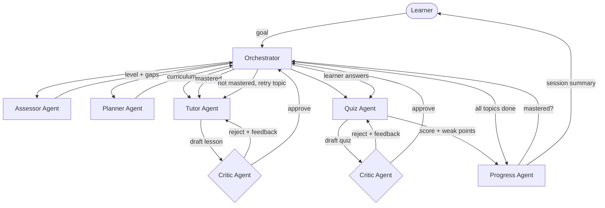

# Foundational Learning — Multi-Agent Tutor

[](https://render.com/deploy?repo=https://github.com/SmartSan/claude-foundational-learning)

A multi-agent AI system built for an **AI for Foundational Learning** hackathon.
It runs a small "society of agents" that assess a learner, plan a curriculum,
teach one topic at a time, quiz understanding, and self-correct — all
coordinated by a deterministic Orchestrator so the whole pipeline is
auditable, not one long opaque prompt.

## Why multi-agent (not one prompt)

A single "teach me X" prompt can't adapt, can't check its own work, and
can't tell you *why* it decided what to do next. Splitting the job into
narrow, single-responsibility agents gets you three things a hackathon judge
can actually see:

1. **Separation of concerns** — each agent has one job and one system prompt.
2. **A self-correction loop** — the Critic agent reviews the Tutor's lesson
   and the Quiz agent's questions *before* the learner ever sees them, and
   can send either back for revision.
3. **An auditable trace** — every agent handoff is logged to
   `SessionState.trace` and shown live in both the CLI and the web demo.

## Architecture



| Agent | Responsibility | Never does |
|---|---|---|
| **Orchestrator** | Deterministic controller — decides which agent runs next based on shared state | Generate any learner-facing content |
| **Assessor** | Diagnostic questions → learner level + knowledge gaps | Teach |
| **Planner** | Turns assessment into an ordered 4-6 topic curriculum | Teach |
| **Tutor** | Teaches exactly one topic, adapted to level; re-teaches on feedback | Quiz or grade |
| **Critic** | Independent quality gate — reviews Tutor & Quiz drafts before they reach the learner | Rewrite content itself |
| **Quiz** | Writes short-answer questions for a topic, grades answers | Teach |
| **Progress** | Deterministic mastery tracking + end-of-session narrative summary | Decide curriculum |

State flows through a single shared `SessionState` object (`src/core/state.py`),
persisted to `data/<session_id>.json` — this is the "blackboard" every agent
reads from and writes its slice to.

## Project structure

```
src/
  core/
    config.py       # env-driven settings (model, thresholds, token limits)
    llm_client.py   # thin Anthropic API wrapper (text + JSON modes)
    state.py         # SessionState — the shared blackboard, JSON-persisted
  agents/
    base.py          # tiny shared base class
    assessor.py
    planner.py
    tutor.py
    critic.py
    quiz.py
    progress.py
  orchestrator.py     # the controller — the only thing that decides "what's next"
backend/
  main.py             # FastAPI wrapper over the Orchestrator, for the web demo
frontend/static/
  index.html          # single-file demo UI (no build step)
cli.py                # terminal demo — run a full session end-to-end
tests/
  test_orchestrator.py  # control-flow tests with LLM calls mocked
```

## Setup

```bash
python3 -m venv .venv && source .venv/bin/activate
pip install -r requirements.txt
cp .env.example .env   # then add your ANTHROPIC_API_KEY
```

## Run the terminal demo

```bash
python cli.py
```

This runs one full session in your terminal: diagnostic → curriculum →
(lesson → quiz) per topic → final summary, printing every agent handoff
as it happens.

## Run the web demo

```bash
uvicorn backend.main:app --reload
```

Then open **http://localhost:8000** — the same Orchestrator state machine,
driven from a browser, with the agent trace shown inline.

## Run the tests

```bash
pytest
```

Tests mock every LLM call and assert on the Orchestrator's control-flow
decisions (does a mastered topic advance the curriculum index? does a low
score trigger remediation instead? does a Critic rejection trigger exactly
one revision round?) — i.e. they test the multi-agent *wiring*, not model
output quality.

## Design notes / trade-offs (for the demo writeup)

- **Orchestrator is rule-based, not an LLM call.** Control flow should be
  auditable and reproducible; only content generation needs a model.
- **Critique loop is capped at one revision** per lesson/quiz to keep a live
  demo fast and API cost predictable — easy to raise `MAX_REMEDIATION_ROUNDS`
  / the revision cap in `orchestrator.py` for a less time-boxed setting.
- **Mastery threshold is deterministic** (`MASTERY_THRESHOLD` in
  `src/core/config.py`), not model-judged, so it's easy to explain and tune.
- **Session state is a plain JSON file per session** rather than a database —
  intentional for a hackathon scope; swapping in a real DB only touches
  `src/core/state.py`.
